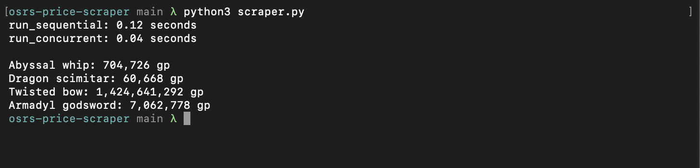

# OSRS Price Scraper

Looks up Grand Exchange prices for Old School RuneScape items from the OSRS Wiki prices API, first one at a time and then with threads, and reports how long each approach took.

## How to use it

Install the one dependency:

```bash
python3 -m pip install requests
```

Run the scraper from the project folder:

```bash
python3 scraper.py
```

The script prints the time each version took, then the average high price for each item in the `ITEMS` dictionary. To scrape different items, change the names and item IDs in `ITEMS`.



## Performance impact

The scraper spends most of its time waiting for the network, not computing, so running requests in parallel saves time.

`run_sequential` uses `map` to fetch each item after the previous one finishes. `run_concurrent` uses `concurrent.futures.ThreadPoolExecutor` and `pool.map` to run four fetches at once, so their waiting overlaps.

| Run | Sequential (s) | Concurrent (s) |
|-----|----------------|----------------|
| 1   | 0.13           | 0.04           |
| 2   | 0.12           | 0.04           |
| 3   | 0.13           | 0.04           |
| 4   | 0.13           | 0.04           |
| Average | 0.13       | 0.04           |

With four items, the concurrent version was about 3 times faster on average. The gap should grow as the item list gets longer.

The functional style also helps. `get_price_history`, `average_price`, and `scrape_item` take their inputs and return results without changing shared data, so each item can be fetched in any order or at the same time without the results interfering with each other.
